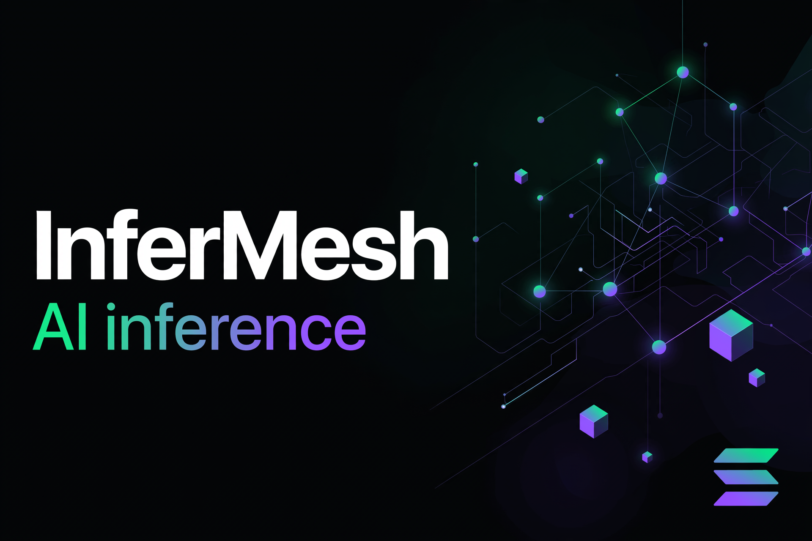

# InferMesh — Open Marketplace for AI Inference on Solana



[](https://github.com/KotalaKishanReddy/infermesh/actions/workflows/ci.yml)
[](https://github.com/KotalaKishanReddy/infermesh/releases)
[](LICENSE)
[](https://solana.com)
[](https://www.anchor-lang.com)
[](https://www.typescriptlang.org)
[](https://www.rust-lang.org)
[](https://github.com/KotalaKishanReddy/infermesh/commits/main)
[](https://github.com/KotalaKishanReddy/infermesh/pulls)

One interface where developers **choose, verify, and pay** AI inference providers.
Built for the Solana [Request for Startups](https://solana.com/request-for-startups)
prompt *"An open marketplace for AI inference"*.

> **Choose** from a staked provider leaderboard · **Verify** outputs are
> untampered (hash commitment) and providers really ran the claimed model
> (reference spot-checks) · **Pay** per job through escrow — no custodial credits.

## ✨ Quickstart (2 minutes, no keys, no SOL)

```bash
npm install
npm run build
npm test          # sdk + backend tests
node demo.mjs     # narrated end-to-end run, no video needed
```

Full interactive UI (3 terminals):

```bash
npm run dev:backend   # REST API  → http://localhost:8787
npm run dev:daemon     # provider worker (mock inference; set OPENAI_API_KEY for hosted)
npm run dev:app        # React demo → http://localhost:5173
```

Submit a prompt in the UI: the daemon claims the job, runs inference, and posts
the result hash. Click **Verify result hash**, then **Confirm + release payout**.

## 🧩 Repo layout

| Path | What it is |
|---|---|
| `programs/infermesh/` | Anchor program: registry with real stake, listings, per-job vault-PDA escrow, owner-checked claims, refunds, disputes. Not yet deployed — the demo settles the identical state machine in `MockLedger`; devnet deploy is grant milestone 1 |
| `sdk/` | Zero-dependency TypeScript SDK: commitments, fee/reputation math, validation, snapshots, `MockLedger` |
| `backend/` | Hardened REST API (body cap, rate limit, security headers, atomic persistence) + provider daemon |
| `app/` | React demo in Solana ecosystem theme |
| `demo.mjs` | Self-running narrated end-to-end demo |
| `GRANT_APPLICATION.md` | Paste-ready grant application ($25k / 3 milestones) |
| `ARCHITECTURE.md` · `DEMO.md` · `SECURITY.md` | Design notes, reviewer walkthrough, audit record |

## 🔐 Security

Internally reviewed in-repo (see [SECURITY.md](SECURITY.md) for the finding
list — 11 findings, all fixed): the program moves real lamports (no
accounting-only payouts), provider actions are owner-checked, unclaimed jobs
are refundable, and the API is validated + rate-limited with atomic
persistence. 20/20 tests green — SDK 11, backend 4 (`npm test`), program 5
(`npm run test:program`: 4 logic + 1 Anchor-generated ID check).

## ⚙️ Config

| Var | Effect |
|---|---|
| `OPENAI_API_KEY` / `OPENAI_BASE_URL` / `INFERMESH_MODEL_MAP` | Route jobs to real hosted models (OpenAI-compatible). Falls back to mock |
| `INFERMESH_PROVIDER_ID` | Which seeded provider the daemon runs as (default `sol-gpu-01`) |
| `INFERMESH_DATA_DIR` | Ledger snapshot directory (default `./data`, atomic writes) |
| `CORS_ORIGIN` | Allowed CORS origin (default `*`; set to the app origin in production) |
| `PORT` | API port (default `8787`) |

API posture: 64 KB body cap, 120 req/min/IP rate limit, strict input
validation, security headers, 15 s request timeouts.

## 📄 License

MIT © 2026 Kotala Kishan Reddy — see [LICENSE](LICENSE).
Built by [@KotalaKishanReddy](https://github.com/KotalaKishanReddy) ·
contact: kishan04586@gmail.com
